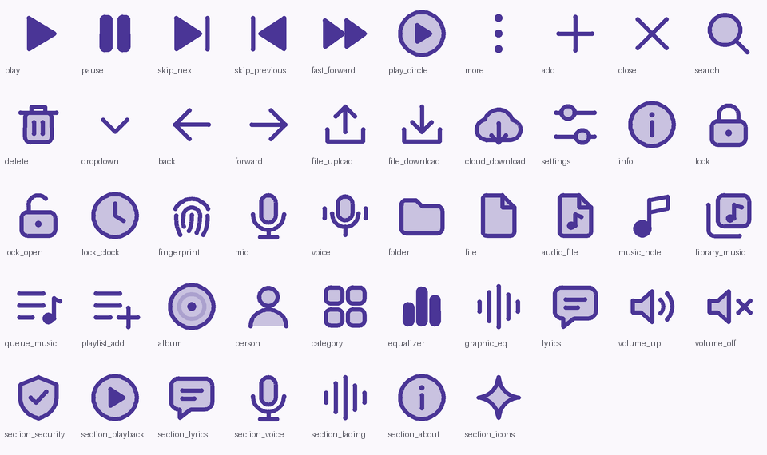

# FukeX icon packs

FukeX can download an optional icon pack from this folder. Nothing here is bundled in the APK: the app fetches
`index.json` (the catalog) and then the `.fxicons` file it lists, from
`https://raw.githubusercontent.com/amanKG777/FukeX/master/iconpacks/`.



## Files

* `index.json` lists the packs: id, name, version, file name, `sha256` and `sizeBytes`. The app refuses a download whose SHA-256 differs.
* `visual-icons.fxicons` is the pack. It is plain JSON despite the extension.
* `tools/build_pack.py` generates both files and `preview.png`. Edit the icons there, run `python iconpacks/tools/build_pack.py --preview`, then commit the results. The unit test `IconPackFormatTest` fails if the catalog checksum is stale.

## Pack format (version 1)

```json
{
  "format": 1, "id": "visual-icons", "name": "Visual Icons", "version": 1,
  "author": "FukeX", "viewport": 24, "strokeWidth": 1.75,
  "icons": {
    "play": { "layers": [ { "d": "M8 5.5 L8 18.5 L18.8 12 Z", "style": "fill" },
                          { "d": "M8 5.5 L8 18.5 L18.8 12 Z", "style": "stroke" } ] },
    "back": { "mirror": true, "layers": [ { "d": "M19 12 L5 12", "alpha": 0.5 } ] }
  }
}
```

* Icons are drawn on a 24x24 grid from SVG path data (`M L H V C S Q T A Z`). A layer is `fill` or `stroke` (default), with an optional `alpha`.
* Colour is ignored: the app tints every icon with the current theme colour, so packs work in light and dark mode.
* `mirror: true` flips an icon in right-to-left languages.
* Strokes always use round caps and joins at `strokeWidth`.
* Icon ids the app uses are the `pick("...")` ids in `ui/FxIcons.kt`, plus the `section_*` ids used for Settings headings. An icon a pack leaves out falls back to the built-in one.
* Limits: 512 KB per pack, 300 icons, 8 layers per icon, 6000 characters per path.

To publish a new version, bump `PACK_VERSION` in `build_pack.py`; installed copies show "update available" through Settings, Visual Icons, Check for icon updates.
